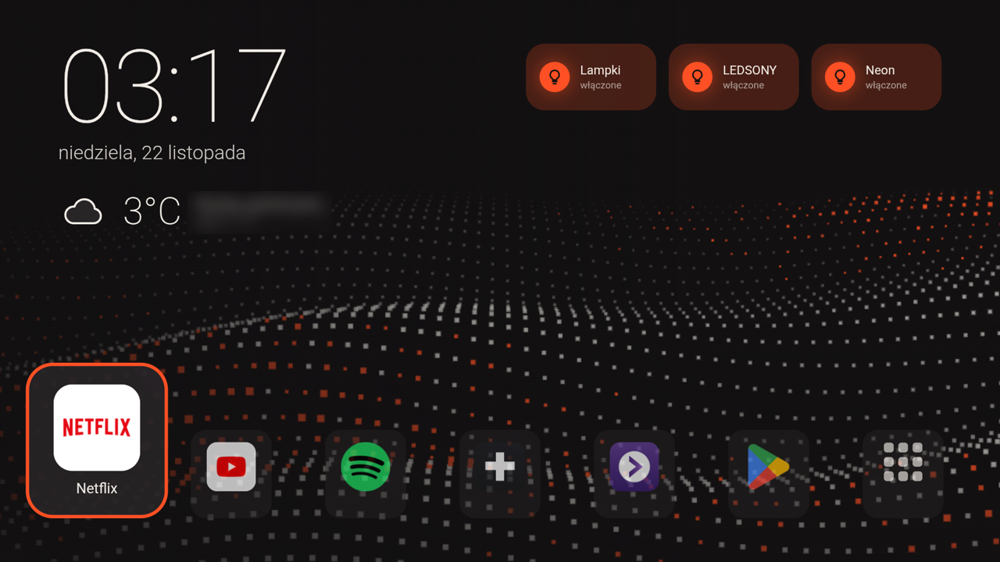

<p align="center"></p>

# Homelab - SmartTV

Back up, clean up and configure your Android TV / Google TV devices over ADB on your home network. One script scans the LAN, takes a scrubbed backup, lists bloatware and disables only what you choose (reversible); an optional tiny launcher replaces the ad-filled home screen with a clock, weather and your apps.



## Quick start

```bash
python tv.py --list-profiles                       # brands and device types
python tv.py sony                                  # scan the LAN, connect, back up, list candidates
python tv.py android-tv --ip 192.168.1.50 --name living-room     # skip the scan, name the device
python tv.py tv-box --pair 192.168.1.50:41234 123456             # Android 11+: one-time pairing
python tv.py tv-box --ip 192.168.1.50 --port 38123               # Android 11+: connect to the debugging port
python tv.py sony --ip 192.168.1.50 --disable com.vendor.demo    # disable (reversible)
python tv.py sony --ip 192.168.1.50 --enable com.vendor.demo     # undo
```

Requirements: Python 3.10+, a TV on the same network with ADB debugging enabled (`adb` is downloaded automatically). Unsure about the brand? Use `android-tv`.

## Docs

| Guide | What is inside |
|---|---|
| [Getting started](docs/getting-started.md) | step by step from first scan to first clean-up |
| [Enable ADB](docs/enable-adb.md) | developer options, Android TV 9-10, Android 11+ wireless debugging, brands without ADB |
| [Debloat](docs/debloat.md) | what is safe to disable, disable vs uninstall, rollback, measuring speed |
| [Launcher](docs/launcher.md) | custom home screen, build, install, set as default, go back |
| [Troubleshooting](docs/troubleshooting.md) | problem → cause → fix (unauthorized, offline, Wi-Fi, pairing, HOME button…) |
| [Privacy](docs/privacy.md) | what is scrubbed, what to review before sharing |

## Safety

- A backup is taken before anything else; `devices/` is git-ignored, never publish it.
- Nothing is disabled without an explicit `--disable`. It uses `pm disable-user`, so `--enable` brings it back.
- Do not touch the system launcher, Google Play services or the Play Store unless you know how to roll back.
- Use only on your own devices, at your own risk.

## Contributing

Pull requests only, with screenshots for visible changes and a Conventional Commits title. See [CONTRIBUTING.md](CONTRIBUTING.md) and [AGENTS.md](AGENTS.md).

---

<p align="center"></p>

# Homelab - SmartTV

Backup, porządki i konfiguracja telewizorów z Android TV / Google TV przez ADB w domowej sieci. Jeden skrypt skanuje sieć, robi backup z wyczyszczonymi danymi, pokazuje bloatware i wyłącza tylko to, co wybierzesz (odwracalnie); opcjonalny mały launcher zastępuje ekran główny pełen reklam zegarem, pogodą i Twoimi aplikacjami.

## Szybki start

```bash
python tv.py --list-profiles --lang pl             # marki i typy urządzeń
python tv.py sony                                  # skan sieci, połączenie, backup, lista kandydatów
python tv.py android-tv --ip 192.168.1.50 --name salon           # bez skanowania, własna nazwa
python tv.py tv-box --pair 192.168.1.50:41234 123456             # Android 11+: jednorazowe parowanie
python tv.py tv-box --ip 192.168.1.50 --port 38123               # Android 11+: port debugowania
python tv.py sony --ip 192.168.1.50 --disable com.vendor.demo    # wyłącz (odwracalnie)
python tv.py sony --ip 192.168.1.50 --enable com.vendor.demo     # cofnij
```

Wymagania: Python 3.10+, telewizor w tej samej sieci z włączonym debugowaniem ADB (`adb` pobiera się sam). Nie znasz marki? Użyj `android-tv`.

## Dokumentacja

Przewodniki są w katalogu `docs/` (tabela powyżej): start, włączanie ADB, odchudzanie, launcher, rozwiązywanie problemów, prywatność. Każdy ma wersję angielską i polską.

## Bezpieczeństwo

- Backup robi się przed jakąkolwiek zmianą; katalog `devices/` jest w `.gitignore`, nigdy go nie publikuj.
- Nic nie jest wyłączane bez jawnego `--disable`. Używamy `pm disable-user`, więc `--enable` przywraca pakiet.
- Nie ruszaj launchera systemowego, usług Google Play ani Sklepu Play, jeśli nie wiesz, jak cofnąć zmianę.
- Tylko na własnych urządzeniach, na własne ryzyko.

## Współtworzenie

Tylko pull requesty, ze zrzutami ekranu przy widocznych zmianach i tytułem w formacie Conventional Commits. Zobacz [CONTRIBUTING.md](CONTRIBUTING.md) i [AGENTS.md](AGENTS.md).
